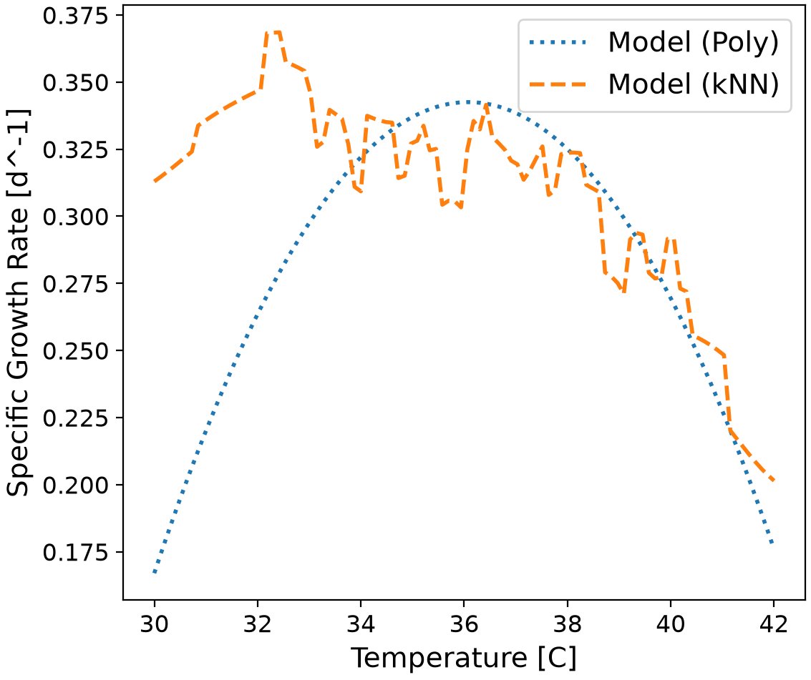

# Predictive Bioprocess Modeling of Specific Growth Rate

This repository contains a comprehensive machine learning pipeline designed to predict the specific growth rate of a cell culture based on historical fermentation data. By analyzing the complex, multidimensional interactions between temperature, pH, glucose concentration, and lactate concentration, this codebase solves the problem of inefficient, trial-and-error bioreactor tuning, allowing engineers to computationally optimize conditions for maximum cellular yield.

## Highlights

* Engineered a robust, modular machine learning pipeline for predictive bioprocess modeling.
* Prevented data leakage by embedding scaling transformations directly within Scikit-Learn pipelines.
* Optimized algorithm hyperparameters utilizing rigorous k-fold Grid Search Cross-Validation.
* Evaluated and contrasted parametric (Polynomial) and non-parametric (kNN) regression architectures.
* Visualized high-dimensional feature interactions using isolated partial dependence plotting techniques.

## Environment

* Python 3.14.7
* matplotlib 3.11.0
* numpy 2.5.2
* pandas 3.0.5
* scikit-learn 1.9.0

## Code Design

The predictive workflow is executed sequentially via the `main.py` script. To ensure code maintainability, readability, and adherence to professional software engineering principles, the underlying mathematical and programmatic logic is modularized into dedicated helper functions stored within the `src/functions.py` file. The execution of the pipeline flows through four major structural stages.

### Initialization, Data Ingestion, and Partitioning
The workflow begins by utilizing the `os` library to verify the existence of the `tables/` and `figures/` directories, dynamically creating them if they do not already exist. Following this, the program utilizes the `pandas` library to ingest the historical dataset from `dataset_cell_growth_4factor.csv`. The script programmatically isolates the specific growth rate into a dedicated target array and maps temperature, pH, glucose, and lactate into an independent feature matrix, immediately converting both structures into pure NumPy arrays. Once ingested, Scikit-Learn's `train_test_split` function is invoked to partition the arrays into a training set (containing 80% of the observations) and a testing set (containing the remaining 20%). A fixed `random_state` parameter is explicitly applied to guarantee that this exact random partition is reproducible across multiple executions. 

This stage is necessary because checking for directories serves as a defensive programming practice that prevents the script from crashing during the final output generation. Furthermore, converting raw comma-separated values into isolated mathematical arrays is a strict requirement for machine learning algorithms. Crucially, partitioning the data before any transformations occur is a fundamental necessity to prevent data leakage, ensuring the model cannot memorize the validation metrics. Ultimately, this stage contributes to the overall workflow by establishing a secure, reproducible foundation. It guarantees that the local file system is prepared and that the raw bioprocess data is structured and segregated perfectly for the mathematical modeling that follows.

### Pipeline Formulation and Preprocessing
This stage constructs two encapsulated `make_pipeline` objects: one designated for Polynomial Regression and the other for k-Nearest Neighbors (kNN) regression. Both of these pipelines embed a `StandardScaler` as their initial operational step. This scaler applies a linear transformation to each individual feature, shifting the distribution such that it possesses a mean of exactly 0 and a standard deviation of 1. The standardized data is subsequently passed into either `PolynomialFeatures` and `LinearRegression`, or a `KNeighborsRegressor`. 

This stage is strictly necessary because the raw biological features operate on vastly different numerical scales. For example, bioreactor temperature is measured in tens of degrees, whereas critical metabolites like glucose or lactate might be measured in single-digit millimolar concentrations. Standardization is required to prevent variables with naturally larger numerical magnitudes from mathematically dominating the distance calculations and algorithmic weights. Additionally, utilizing a pipeline object is a highly secure method of encapsulating multiple data transformations into a single, cohesive unit. This significantly simplifies the workflow and strictly prevents the training data's scaling parameters from leaking into the test dataset during cross-validation. This stage contributes to the overall workflow by standardizing the mathematical playing field. By binding the preprocessing steps directly to the machine learning estimators, it creates a robust, automated sequence that ensures every piece of data fed into the models is scaled identically and safely.

### Hyperparameter Optimization (GridSearchCV)
In this stage, the formulated pipelines are fed into a `GridSearchCV` function alongside a predefined dictionary of potential hyperparameter settings. For the polynomial model, the grid searches polynomial degrees ranging from 1 through 4. For the kNN model, it evaluates $k$-values from 1 to 80 across both uniform and distance weighting schemes. The grid search utilizes 5-fold cross-validation, automatically dividing the 80% training data into 5 smaller, isolated sub-folds. It trains the algorithms on four of these folds and validates on the fifth, repeating this iterative process to calculate the average Root Mean Square Error (RMSE) for every possible hyperparameter combination. 

This stage is necessary because while algorithms automatically learn internal parameters, hyperparameters are structural settings that must be manually defined by the engineer. The optimal value of a hyperparameter cannot be learned during standard training; we must systematically test these configurations to balance the bias-variance tradeoff. Cross-validation heavily reduces the evaluation metric's dependence on any single, randomized data split. This stage contributes to the overall workflow by acting as the primary tuning engine. It rigorously maps out the hyperparameter space to automatically locate the specific configuration that minimizes error, returning the mathematically optimized models ready for final testing.

### Final Evaluation and Metric Extraction
The optimal Polynomial and kNN models identified by the grid search are finally exposed to the completely unseen 20% test data partition. The script utilizes these models to predict the target growth rates, compares these predictions to the true historical values, and calculates the final root mean squared error alongside the coefficient of determination ($R^2$). These final metrics are exported as a structured CSV summary table. Following this, the script extracts the linear coefficients from the winning Polynomial model and generates a sorted bar chart visualizing the top feature weights. 

This stage is necessary because the evaluation metrics provide the rigorous, empirical proof required to determine which architectural approach best captured the underlying bioprocess dynamics. Extracting the polynomial weights is absolutely vital to achieve algorithmic interpretability. Because the data was standardized before being passed through the polynomial regression step, we can directly interpret these resulting weights to understand which specific environmental factors exert the strongest influence on the physical cell culture. This stage contributes to the overall workflow by translating abstract mathematical models into concrete, actionable business logic. It provides bioprocess operators with clear, quantified evidence of algorithmic performance, fulfilling the core objective of the predictive pipeline.

## Analysis

### Justification of Model Architecture

The selection of the final predictive architecture relies on balancing mathematical complexity with generalizable accuracy, heavily informed by the bias-variance tradeoff. Through the implementation of `GridSearchCV`, the polynomial regression model was rigorously evaluated across degrees 1 through 4.

The empirical evidence generated in the polynomial validation curve clearly demonstrates that a Polynomial Degree of 2 or 3 represents the optimal structural architecture. At Degree 1, the model severely underfits the data, unable to capture the natural, nonlinear saturation kinetics characteristic of biological cell growth (resulting in high training and high test RMSE). However, pushing the architecture to Degree 4 or higher forces the model into classic overfitting; the training error rapidly approaches zero as the equation memorizes random noise, while the validation error spikes exponentially. Therefore, a low-degree polynomial (Degree 2 or 3) is justified as it beautifully captures the smooth, continuous physical nature of biological temperature and pH dependencies without succumbing to variance.

### Comparative Analysis of Regression Algorithms

When comparing the chosen Polynomial model against the non-parametric k-Nearest Neighbors (kNN) algorithm, the Polynomial architecture demonstrates distinct advantages for this specific multidimensional bioprocess.

As evidenced in the kNN validation curve, the algorithm exhibits a steep error trajectory. At extremely low values of $k$ (e.g., $k=1$ or $2$), kNN drastically overfits the data, tracing individual, noisy data points rather than identifying global biological trends. While the kNN validation error does dip to a minimum as $k$ increases, it eventually climbs steadily as $k$ approaches 80 (underfitting), where the algorithm averages too many disparate conditions and simply predicts the global mean of the dataset.

Furthermore, kNN relies on calculating Euclidean distance across four dimensions (Temperature, pH, Glucose, Lactate). In high-dimensional spaces, distance-based metrics often degrade in predictive power—a phenomenon known as the "curse of dimensionality." Conversely, Polynomial Regression maps a continuous, mathematically defined surface over the data, which more accurately reflects the continuous nature of enzyme kinetics and cell metabolism, making it the mathematically superior alternative.

### Advantages and Limitations of the Predictive Model

A primary advantage of the Polynomial Regression model is its high degree of interpretability. Because the features were processed via a `StandardScaler`, the resulting polynomial coefficients directly quantify the biological impact of each feature and their interacting terms. Engineers can instantly see exactly how strongly pH or Temperature drives the growth rate. Additionally, polynomial models are computationally inexpensive to deploy in real-time, executing basic algebraic equations rather than forcing a system to recalculate distances across thousands of historical training points (as required by kNN).

However, a major limitation of this polynomial architecture is its extreme vulnerability to extrapolation. Polynomial equations tend to diverge violently toward positive or negative infinity when fed input values that exist outside the boundaries of the original training data. If a bioreactor experiences a temperature spike far beyond the maximum temperature seen in the dataset, the model may predict an impossible, infinitely negative growth rate rather than a simple zero. It is strictly interpolative.

### Biological Influence of Process Parameters

The extracted model weights and generated partial dependence plots provide deep insight into how the four target parameters govern the specific growth rate.

* **Temperature:** This is typically the dominant driving force in cellular metabolism. As seen in the temperature dependence curve below, isolating this variable reveals a classic biological activity curve. As temperature rises, enzymatic activity and growth rate increase exponentially until an absolute thermal optimum is reached, after which the growth rate plummets rapidly due to sudden protein denaturation.

* **pH:** Cellular growth is highly sensitive to the concentration of hydrogen ions, which directly impact membrane potential and the structural integrity of transport proteins. The model identifies a tight, optimal pH band. Deviations to either highly acidic or highly basic conditions rapidly suppress the growth rate.
* **Glucose Concentration:** As the primary carbon and energy source, glucose exhibits a strong positive correlation with growth rate at lower concentrations, adhering to standard Monod kinetics. However, the model correctly captures that excessive glucose does not yield infinite growth; the cells eventually become saturated, and the growth rate plateaus regardless of additional glucose supplementation.
* **Lactate Concentration:** Lactate acts as a metabolic byproduct and a known cellular inhibitor. The polynomial weights accurately reflect a strong negative coefficient for lactate. As lactate accumulates in the media over the duration of a batch, it increases osmotic stress and lowers the local pH, cumulatively suppressing the specific growth rate.

### Optimal and Suboptimal Cell Culture Conditions

Based on the synthesized model, cell culture conditions that result in a highly optimal specific growth rate require maintaining a delicate equilibrium. The highest growth rates are achieved when the bioreactor temperature is held precisely at the peak of the thermal optimum curve, accompanied by a strictly neutral or slightly optimized pH. Furthermore, glucose must be maintained at a sufficiently saturating level (to avoid starvation) while lactate concentrations must be kept as close to zero as physically possible to prevent metabolic inhibition.

Conversely, suboptimal conditions leading to low or zero specific growth rates occur when this equilibrium is broken. Significant drops in temperature will drastically slow down enzymatic kinetics, stalling growth. High temperatures will denature enzymes, rapidly killing the culture. Furthermore, late-stage fermentation conditions characterized by deeply depleted glucose reserves and heavy, toxic lactate accumulation will yield the lowest predicted growth rates in the dataset.

### Boundary Constraints and Model Reliability

The predictions generated by this polynomial model are highly reliable only when interpolating *within* the multidimensional boundaries of the historical training data. The model's predictions become exceedingly unreliable—and potentially mathematically impossible—if queried with extreme conditions. For example, if the model is asked to predict the growth rate at 100°C or at a pH of 1.0, the polynomial equation may output a massive positive or negative number due to the unbounded nature of high-degree algebraic curves. The model possesses no inherent biological knowledge; it does not "know" that cells die at boiling temperatures unless the training data explicitly maps out that boundary.

### Industrial Applications and Practical Implementation

In a practical industrial setting, this predictive machine learning model functions as the core logic for a "Digital Twin" or a soft sensor. By feeding real-time sensor data (Temperature, pH) and offline metabolite samples (Glucose, Lactate) into the deployed model, process engineers can instantly estimate the current specific growth rate without waiting for tedious, delayed offline cell counts.

Furthermore, this model can be integrated directly into automated Model Predictive Control (MPC) systems. If the model detects that the predicted growth rate is dropping due to rising lactate and falling glucose, it can automatically trigger a perfusion system to cycle in fresh media or initiate a precise, calculated glucose feed, ensuring the bioreactor operates at peak efficiency and maximum yield throughout the entire duration of the manufacturing campaign.