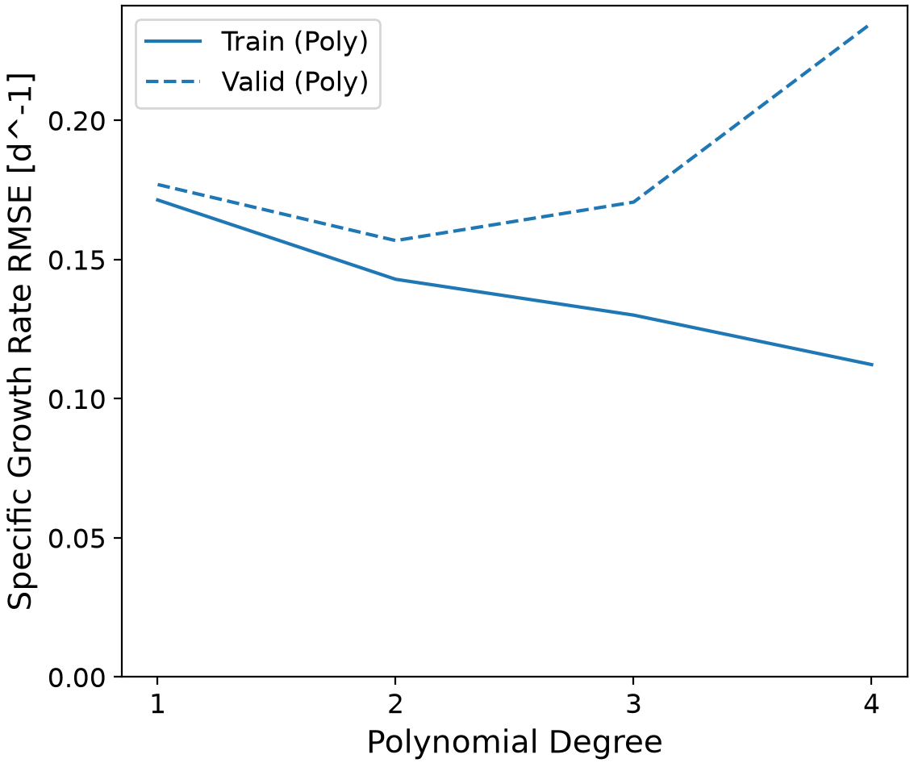
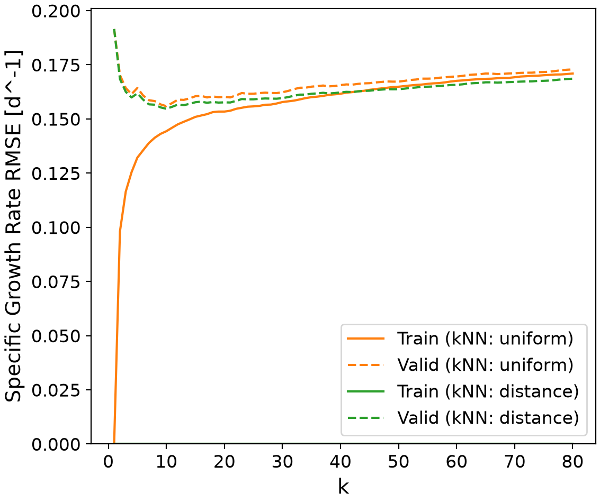
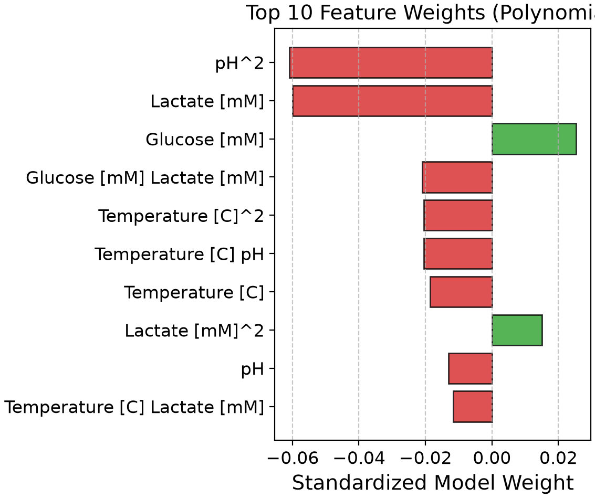

# Predictive Bioprocess Modeling of Specific Growth Rate

This repository contains a machine learning pipeline designed to predict the specific growth rate of a cell culture using a four-factor bioprocess dataset. The code evaluates and compares polynomial regression against k-nearest neighbors (kNN) regression to determine which architecture best models the non-linear kinetics of cell growth based on temperature, pH, glucose, and lactate concentrations.

## Highlights

*   Engineered a Scikit-Learn pipeline to automate data scaling and regression modeling.
*   Optimized model hyperparameters systematically using 5-fold grid search cross-validation.
*   Evaluated algorithmic bias-variance tradeoffs by generating and analyzing validation curves.
*   Visualized temperature dependence using partial dependence plots to isolate single-variable effects.
*   Analyzed standardized polynomial feature weights to interpret underlying biological drivers.

## Environment

*   Python 3.14.7
*   matplotlib 3.11.0
*   numpy 2.5.2
*   pandas 3.0.5
*   scikit-learn 1.9.0

## Code Design
The predictive workflow is executed sequentially via the `main.py` script. The underlying mathematical and program logic is modularized into helper functions stored within the `src/functions.py` file. The execution of the pipeline flows through four major structural stages.
### Initialization and Data Partitioning
The execution of `main.py` begins by establishing the local environment. The `os` module checks for the existence of `tables/` and `figures/` directories, generating them if they are missing to prevent file-path errors during export. The script then uses `pandas` to read `dataset_cell_growth_4factor.csv`. The target variable (Specific Growth Rate) is isolated from the input features (Temperature, pH, Glucose, Lactate), and both structures are converted into NumPy arrays. 

Following ingestion, `train_test_split` partitions the data, setting aside 20% as an untouchable test set and retaining 80% for training. A fixed random state is applied to guarantee that the split is exactly reproducible across different runs. This partitioning step is necessary to prevent data leakage. If a model is evaluated on the same data used to train it, the resulting error metrics will only reflect the model's ability to memorize the dataset rather than its ability to generalize to new, unseen bioprocess batches. Setting the test set aside immediately ensures the final evaluation remains strictly objective.

### Pipeline Formulation and Preprocessing
Once the data is split, the script constructs two modeling pipelines using Scikit-Learn's `make_pipeline`. The first pipeline combines a `StandardScaler`, `PolynomialFeatures`, and `LinearRegression`. The second combines a `StandardScaler` with `KNeighborsRegressor`. 

This preprocessing stage is necessary because the raw variables operate on completely different numerical scales. For example, temperature is measured in tens of degrees, while pH operates on a logarithmic scale. Distance-based algorithms like kNN rely heavily on Euclidean geometry; without scaling, features with naturally larger numbers will mathematically dominate the distance calculations, rendering smaller-scale variables functionally invisible to the model. 

Embedding the `StandardScaler` directly inside the pipeline rather than applying it to the raw dataset is critical for maintaining cross-validation integrity. It ensures that during the grid search, the scaler calculates its mean and standard deviation strictly on the active training fold, applying those exact parameters to the validation fold. This simulates a real-world scenario where the model processes genuinely new data without being influenced by the statistical distribution of the test set.

### Hyperparameter Optimization
With the pipelines formulated, the script passes them into `GridSearchCV` objects to tune their structural settings. The polynomial grid search iterates through polynomial degrees 1 through 4. The kNN grid search evaluates values of $k$ (number of neighbors) from 1 to 80, testing both distance-based and uniform weighting algorithms. The search engine uses 5-fold cross-validation, dividing the 80% training data into five smaller subsets. It trains the model on four subsets and tests it on the fifth, rotating this process to calculate an average Root Mean Square Error (RMSE) for every single hyperparameter combination.

This optimization stage is necessary because the default algorithm settings are rarely suited to complex biological data. If the polynomial degree is too low, the model underfits and fails to capture the curvature of cell saturation points. If the degree is too high, it overfits the noise. Cross-validation systematically brute-forces the hyperparameter space to locate the optimal balance between bias and variance, ensuring the final selected model relies on actual biological trends rather than statistical anomalies.

### Final Evaluation and Output Generation
In the final stage, the script extracts the best-performing estimators from both grid searches and exposes them to the 20% test set for the first time. The script calculates the final RMSE and $R^2$ scores, documenting the empirical performance of both the parametric and non-parametric approaches. 

These results are exported as a CSV summary table. Next, the script extracts the linear coefficients from the winning polynomial model and generates a sorted horizontal bar chart of the top 10 feature weights. Finally, it dynamically renders and saves PNG figures for the data scaling comparisons, validation curves, and the temperature partial dependence plot. This stage is necessary because it translates the abstract matrix mathematics back into concrete, interpretable engineering deliverables. The exported metrics provide process engineers with the quantified evidence needed to justify implementing the predictive model in a live bioreactor monitoring system.

## Analysis

### Model Architecture Selection
Based on the exported metrics and visualization outputs, the polynomial regression architecture (specifically Degree 2) outperformed the k-Nearest Neighbors approach for this multidimensional bioprocess dataset. 

Polynomial regression is a parametric model, meaning it assumes the underlying data follows a specific mathematical structure. By applying a Degree 2 expansion, the model generates squared terms and interaction variables, allowing it to fit the parabolic curves characteristic of biological saturation kinetics. Cell cultures typically exhibit distinct optimal ranges for parameters like temperature and pH, where growth peaks and then rapidly declines as conditions become extreme. A second-degree polynomial perfectly maps this behavior without becoming overly complex.

In contrast, kNN is a non-parametric model that calculates predictions by averaging the historical data points closest to the new input. While kNN can be highly effective in low-dimensional spaces, it struggles with this dataset due to the "curse of dimensionality." Because there are four distinct features (Temperature, pH, Glucose, Lactate), the geometric volume of the feature space is very large. As a result, the "nearest" neighbors are often physically far away, leading to jagged, less accurate predictions. The continuous mathematical equation provided by the polynomial model proved much better suited to interpolating the spaces between the training samples.

### Validation Curves and Hyperparameter Tuning
The exported validation curves provide clear evidence for the hyperparameter selections. 

Looking at the polynomial validation curve, Degree 1 exhibits high error on both the training and validation lines, indicating severe underfitting. The linear equation simply cannot map the curved peak of cell growth. At Degree 2, both training and validation RMSE drop to their absolute minimum. However, at Degrees 3 and 4, the training error continues to artificially decrease while the validation error spikes upward. This divergence is the textbook definition of overfitting; the high-degree polynomials start memorizing the random measurement noise in the training set, destroying their ability to predict the specific growth rate on new validation folds.

The kNN validation curve displays the inverse relationship. When $k$ is extremely small ($k=1$ or $2$), the model exhibits low training error but high validation error because it only looks at a single localized point, making it highly susceptible to outliers. As $k$ increases, the validation error drops smoothly to an optimal point. However, as $k$ approaches 80, the model begins to underfit. By averaging too many neighbors, it blurs the distinct biological conditions together, essentially predicting the global average of the entire dataset regardless of the specific input values. The grid search correctly identified the lowest point on the validation curve, but its overall RMSE remained higher than the Degree 2 polynomial model.

### Feature Influence on Specific Growth Rate
To understand the biological mechanics driving the predictions, we must analyze the standardized weights extracted from the polynomial model. Because the data was scaled to a mean of 0 and a standard deviation of 1 before fitting, the magnitude of these linear coefficients directly correlates to the feature's physical influence on the specific growth rate.

Temperature and pH exhibit strong parabolic influences, represented by significant negative weights on their squared terms ($Temperature^2$ and $pH^2$). In biological terms, this negative parabolic shape confirms that both variables have a defined optimal setpoint. As you move away from that setpoint in either direction—making the environment too hot, too cold, too acidic, or too basic—the squared term dominates the equation and pulls the predicted specific growth rate down.

Glucose concentration serves as the primary carbon and energy source for the cell culture, presenting a positive linear correlation in the model weights. An increase in available substrate generally drives an increase in metabolic activity and cell division. 

Conversely, lactate concentration exhibits a strong negative weight. Lactate is a metabolic byproduct of cellular respiration and glycolysis. As it accumulates in the bioreactor, it lowers the local pH and creates a toxic, inhibitory environment for the cells. The model correctly identified that high concentrations of lactate heavily suppress the specific growth rate.

### Optimal and Sub-Optimal Cell Culture Conditions
Based on these feature relationships, we can define the specific environmental conditions that dictate bioreactor performance.

**Conditions for High Specific Growth Rate:**
To achieve maximum cell growth, the bioreactor must be strictly controlled near the mathematical apex of the temperature and pH parabolas. This optimal zone represents the conditions where cellular enzymes function at peak efficiency without risking thermal denaturation or structural degradation. Additionally, the process requires high initial concentrations of glucose to ensure substrate is not a limiting factor, combined with low concentrations of lactate. This prevents end-product inhibition and keeps the metabolic pathways flowing smoothly.

**Conditions for Low Specific Growth Rate:**
A low specific growth rate will occur if the temperature or pH deviates significantly from the optimal setpoints, leading to sluggish enzyme kinetics or cell death. Furthermore, nutrient starvation (low glucose) directly halts cell division. Even if glucose, pH, and temperature are optimal, an accumulation of high lactate concentrations late in the fermentation batch will inhibit the culture, drastically reducing the growth rate.

**Unreliable Model Predictions:**
The model's predictions become highly unreliable when operators input conditions that fall outside the numerical range of the original training data (extrapolation). Polynomial models are particularly dangerous in this regard; because they follow mathematical trajectories that stretch toward infinity, inputting a temperature of 90°C might cause the model to predict a massive, impossible surge in growth, rather than recognizing that the cells would simply boil and die. The model is strictly empirical, meaning it only understands mathematical patterns within the data it was given. It does not understand the actual physical boundaries of biology.

### Practical Applications and Limitations
In a real-world chemical engineering context, this predictive model could be integrated into a bioreactor's supervisory control and data acquisition (SCADA) system. By feeding real-time sensor data (pH, temperature, and offline glucose/lactate samples) into the model, process engineers could monitor the instantaneous specific growth rate without waiting for manual cell counts. It could also be used for feed-forward process control; if the model predicts a drop in growth rate due to impending glucose depletion, the control system could automatically trigger a nutrient feed pump to maintain optimal saturation.

The primary limitation of this pipeline is its purely data-driven nature. Unlike mechanistic models (such as Monod kinetics or Michaelis-Menten equations) which are built on fundamental stoichiometric and thermodynamic principles, this polynomial model is just a line of best fit. If the manufacturing facility switches to a slightly different cell line, or scales up the process from a 10-liter benchtop reactor to a 5,000-liter pilot plant, the fluid dynamics and mass transfer characteristics will change. Because this empirical model does not actually "know" the biology, the underlying polynomial coefficients would become immediately obsolete, requiring a completely new dataset to be generated, scaled, and re-tuned.
